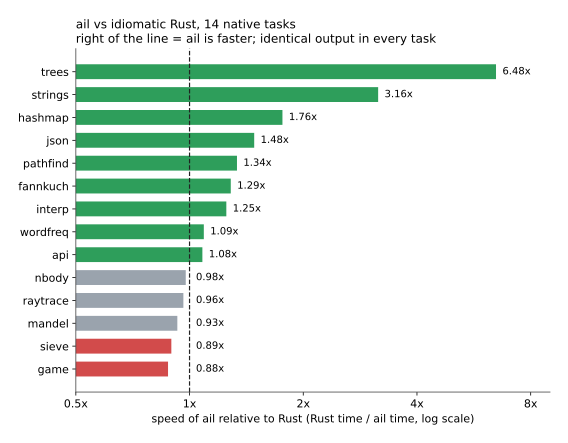
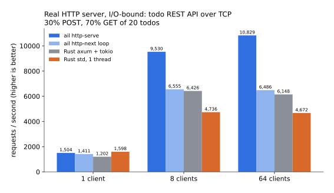
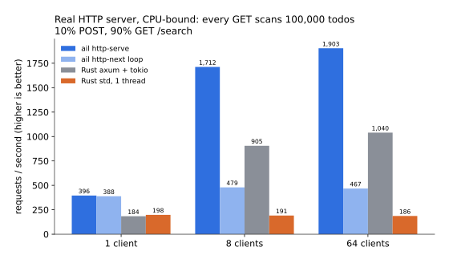
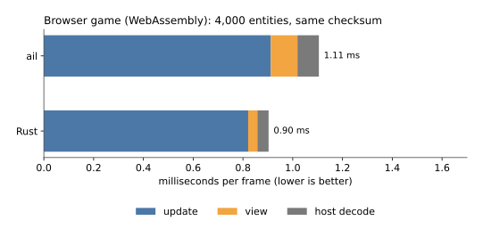
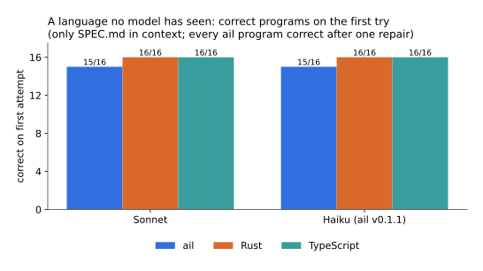

# ail

**A programming language designed to be written by AI agents.** ail aims to be fast enough to
replace Rust and C++ and safe enough that common bad practices cannot be written at all.

ail started from a blank page. It is not a dialect or a wrapper of an existing language. Every
choice starts from one question: what does a model need in order to write correct, fast code on
the first attempt?

- **The whole language fits in a prompt.** `SPEC.md` is about 4,000 words, and `ail spec`
  prints it. A model that has never seen ail learns it from that page.
- **Syntax is typed s-expressions.** A model cannot misread operator precedence or layout.
  If the parentheses are off, the compiler uses the indentation as a second source of the
  intended structure and repairs them (warning `W0004`).
- **Values, not references.** Values have no shared mutable aliases. Mutation is marked where
  the call happens, as `(mut x)`, so data races and aliasing bugs cannot be written.
- **Functions are arguments, never values.** A parameter can be `(Fn A B R)` and the caller
  passes a `lambda`; `map`, `filter`, `fold`, `sort-by` and friends take them. Lambdas only read
  their surroundings and cannot be stored, so there are no capture rules and no allocation.
- **Generics without bounds.** `(type-params T)` on fns, structs and enums. Each concrete use is
  checked and compiled as its own copy, so there is no trait syntax and no runtime cost.
- **Parallelism that cannot race.** `(par-map xs f)` runs on every core and returns exactly what
  `map` would: values are never shared, lambdas only read, and no effects are allowed inside.
- **Loops that parallelize themselves.** A plain `for` whose iterations are independent (sums,
  histograms, running maxima, writes to its own elements, pushes, prints) runs on every core with
  no change to the source. Results, output order and traps are exactly those of the sequential
  loop.
- **Concurrent I/O.** `(par-run xs f)` runs `f` on up to 64 elements at once for work that waits
  on the network or the disk, and `http-request` is an HTTP client with kept-alive connections.
- **Tasks and channels without deadlocks.** `(tasks (channel c T) (task (out c) ...) (task (in c) ...))`
  runs tasks at the same time. Every channel has one sender and one receiver, the tasks form no
  cycle, and a variable is changed by at most one task. A deadlock or a data race cannot be
  written, and the output does not depend on timing.
- **Servers where GET cannot write.** `(http-serve net port max-body state read write)` runs GET
  handlers in parallel with read-only access to the state, and every other method one at a time
  with `mut` access. A GET with side effects does not compile, and handlers cannot race.
- **Effects are capabilities.** A function can print, read files or open sockets only if it was
  given that capability, and capabilities come down from `main`.
- **No undefined behavior.** Integer overflow, out-of-bounds access and failed `expect` stop the
  program with a clear message. Nothing continues silently with corrupted state.
- **Compiler errors are data.** Each diagnostic is JSON with an exact span and fixes a machine
  can apply. `ail fix` applies them until the program compiles.
- **One language for native programs, servers and the browser.** The compiler emits Rust and
  compiles it with LLVM, for native targets and WebAssembly.

## Benchmarks

Each task is specified exactly in [`bench/SPECS.md`](bench/SPECS.md). Each language version was
written by its own AI agent, working without seeing the other: one idiomatic Rust program (using
`serde` where natural, built with fat LTO and overflow checks off) and one idiomatic ail program
(overflow and bounds checks always on). **Every row produces byte-identical output.** Times are
the best of 5 to 9 whole-process runs on a Ryzen 5 2600 under Windows 11, with ail and Rust runs
interleaved so that load from other programs hits both equally.

### Native: 15 tasks



| task | what it exercises | ail | Rust | ail/Rust time |
|---|---|---|---|---|
| trees | allocation-heavy binary trees | 7.79 s | 50.48 s | **0.15** |
| strings | string building and search | 0.18 s | 0.56 s | **0.32** |
| hashmap | integer hash map | 1.54 s | 2.72 s | **0.57** |
| json | build, serialize, parse 40k-record documents | 2.06 s | 3.06 s | **0.67** |
| pathfind | A* search | 0.051 s | 0.069 s | **0.75** * |
| fannkuch | permutations, array indexing | 2.69 s | 3.45 s | **0.78** |
| interp | bytecode VM, enum dispatch | 2.30 s | 2.87 s | **0.80** |
| wordfreq | tokenize 3M words, count, sort | 0.31 s | 0.34 s | **0.92** |
| pipeline | 3 stages on 3 threads joined by channels (`tasks` vs std mpsc) | 0.88 s | 0.95 s | **0.93** |
| api | REST handlers: routing, JSON in and out, store | 2.78 s | 3.00 s | **0.93** |
| nbody | f64 struct math | 2.92 s | 2.85 s | 1.02 |
| raytrace | f64 vector math, enum shapes | 0.024 s | 0.024 s | 1.04 * |
| mandel | Mandelbrot, rows in parallel (`par-map` vs rayon) | 1.02 s | 0.95 s | 1.08 |
| sieve | bounds-checked array loops | 4.14 s | 3.71 s | 1.12 |
| game | 4,000-entity arena with a spatial grid | 1.57 s | 1.38 s | 1.14 |

\* These runs take under 0.1 s, so process start-up dominates them.

### Real HTTP server





The same todo REST API runs over TCP on localhost, against a hand-written single-threaded Rust
`std` server and against `axum` on `tokio`, multi-threaded, with the store in an `RwLock`. Every
request opens a new connection, and every server starts with 100,000 todos. Each cell is the best
of two 10 s rounds after a 2 s warmup.

There are two ail servers:

- **`http-next` loop:** the program takes one request at a time. The runtime accepts and parses
  requests on a pool of I/O threads.
- **`http-serve`:** GET handlers run in parallel and only read the state. Writes run one at a time.
  The language makes data races and side-effecting GETs impossible to write.

Results:

- **I/O-bound mix** (30% `POST`, 70% `GET` of 20 todos): `http-serve` does 9,530 to 10,829
  requests/s with 8 and 64 clients, which is 1.5 to 1.8 times axum.
- **CPU-bound mix** (90% `GET /search`, each scanning the whole store): 1,712 to 1,903 requests/s,
  which is 1.8 to 1.9 times axum and 3.6 to 4 times the one-at-a-time ail loop.

Even on one thread, ail's scan runs twice as fast as Rust's. ail's allocator keeps the small
strings of the store contiguous, so the scan stays in cache.

Calling a service is just as direct. `(par-run qs (lambda (q) (http-request net "GET" url (map) "")))`
sends 3,000 requests, 64 at a time, over kept-alive connections. It takes 0.64 of the time of tokio +
reqwest when the answers are cheap, and 0.93 when the backend does the work.

Two requests out of about a million failed. Both were client-side `connect` errors (Windows
error 10055, out of socket buffers), not server errors.

### Browser game (WebAssembly)



[`bench/web/arena.ail`](bench/web/arena.ail) is the `game` world written as a browser app.
It is compared with the same game in Rust compiled to wasm without wasm-bindgen. A headless
harness on Node drives both versions for 1,500 frames, and both end with the same checksum as the
native run. ail takes 1.11 ms per frame and Rust 0.90 (1.22x); the ail module is 78 KB.


### Can a model write a language it has never seen?



Fresh agents got console tasks with hidden tests and nothing but the task and `SPEC.md`, and
wrote each program once, with no compiling and no testing. In r2 (16 tasks) ail compiled as often
as Rust and TypeScript. r3 has 8 harder tasks: an order book, 64-bit road lengths past 2^53, an
interpreter that must detect overflow, a CPU scheduler, JSON queries, hashing. Each language missed
at most one per model there. Both ail misses were compiler bugs (the checker was stricter than
the spec), fixed since, after which those unchanged programs pass. TypeScript's miss was a real
logic bug. Details are in [`experiment/RESULTS.md`](experiment/RESULTS.md).

**Speed of the code models write.** r4 and r5 time the ail and the Rust that the same model wrote
for seven compute-heavy tasks. When the statement mentions 12 cores (r4), the models write threaded
Rust and ail is 1.3 times slower on average. When it does not (r5), they write sequential code in
both languages, and ail's self-parallelizing loops make it faster on average (0.81 of the Rust
time): 1.7 to 2.6 times faster on kmeans and matrix product, and still 1.3 to 1.9 times slower on
tasks that are sequential by nature.

The task statements are public, in `experiment/tasks*/`. The hidden tests, and the Python
generators that produce them, are not: published tests would end up in training data, and the
tasks would stop measuring anything.

### Where ail still loses, and what comes next

- **game and sieve (~1.1×):** bounds checks in the inner loops, and the ail game keeps its grid as
  a `Vec` of `Vec`s where the Rust version uses a flat array. Overflow checks turned out not to be
  the cost: switching them off changes these times by 0 to 4%.
- **Browser view:** the Rust version sends palette indices to the host; ail sends interned color
  strings.

ail 0.4 added string views: a `Str` is still a value, but read-only parameters, substrings,
trimmed and lower-cased strings and helpers that return part of their argument are borrowed
instead of copied whenever the compiler can prove nobody could tell. That took wordfreq from
1.58× to 0.92× and strings from 0.50× to 0.32×.

Full write-up: [`bench/RESULTS.md`](bench/RESULTS.md). Charts are generated by
[`bench/charts.py`](bench/charts.py).

## A taste

```lisp
(struct Todo (id I64) (title Str) (done Bool))

(fn page-size (params (req Request)) (returns I64)
  (body
    (match (get (. req query) "limit")
      (case (some s) (min 100 (max 1 (unwrap-or (parse-i64 s) 20))))
      (case none 20))))

(fn add (params (todos (mut (Vec Todo))) (title Str))
  (body (push (mut todos) (new Todo (id (len todos)) (title title) (done false)))))

(fn main (params (con Console))
  (body
    (var todos (Vec Todo) (vec))
    (add (mut todos) "write the spec")
    (println con (json-str todos))))
```

When something is wrong, the compiler answers with data that another program can act on:

```json
{"code":"E0501","message":"match is not exhaustive: missing Color.Blue",
 "span":{"line":5,"col":5,"end_line":7,"end_col":34},
 "fixes":[{"description":"add the missing arms (replace each placeholder body)",
           "edits":[{"span":{"line":7,"col":33},
                     "text":" (case Color.Blue (fail \"TODO: handle Blue\"))"}]}]}
```

## Quick start

You need Rust (stable). For browser builds, also run `rustup target add wasm32-unknown-unknown`.

```
cd compiler && cargo build --release
target/release/ail run ../examples/hello.ail
target/release/ail check ../examples/broken.ail --json
target/release/ail fix ../examples/broken.ail
target/release/ail web ../examples/dodge.ail          # build for the browser and serve it
```

| command | what it does |
|---|---|
| `ail check <file> [--json]` | type, capability and aliasing check (instant) |
| `ail run <file>` | compile (cached) and run |
| `ail test <file>` | run the `(test ...)` blocks |
| `ail build <file> [--target web]` | optimized native binary, or `index.html` + `app.wasm` |
| `ail fix <file>` | apply every machine-applicable fix, repeatedly |
| `ail emit <file>` | print the generated Rust |
| `ail spec` | print the language specification |

## Repository

| path | contents |
|---|---|
| [`SPEC.md`](SPEC.md) | the whole language |
| [`DESIGN.md`](DESIGN.md) | why each decision was made |
| [`compiler/`](compiler) | the compiler (Rust): parser, checker, Rust emitter, runtime |
| [`bench/`](bench) | ail vs Rust: native tasks, HTTP server, browser game |
| [`experiment/`](experiment) | AI agents writing ail vs Rust vs TypeScript |
| [`examples/`](examples) | programs, including a JSON REST API and a browser game |
| [`tests/`](tests) | language tests, run with `ail test` |
| [`tools/`](tools) | `regress.py` (every program still builds and passes) and `ab.py` (compiler A/B timing) |

## Status

ail is an early research language: v0.3 is released and v0.4 (string views, functions as
arguments, generics, programs split across files with `(use name)`, `par-map` and `par-run`,
tasks and channels, concurrent servers with `http-serve`, an HTTP client) is in development on
`main`. The pieces above work and are measured. Still to
come: keep-alive on the server side, https, and tasks that live alongside a server.

## License

MIT. See [`LICENSE`](LICENSE).
